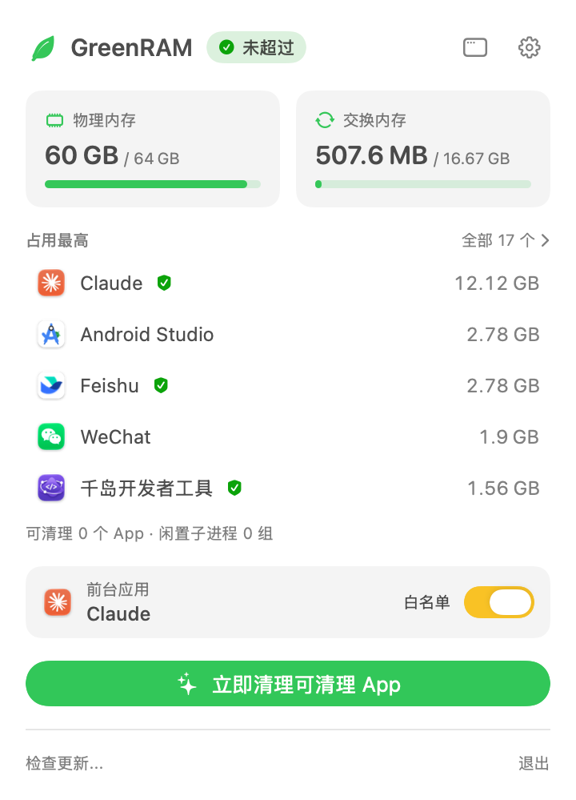
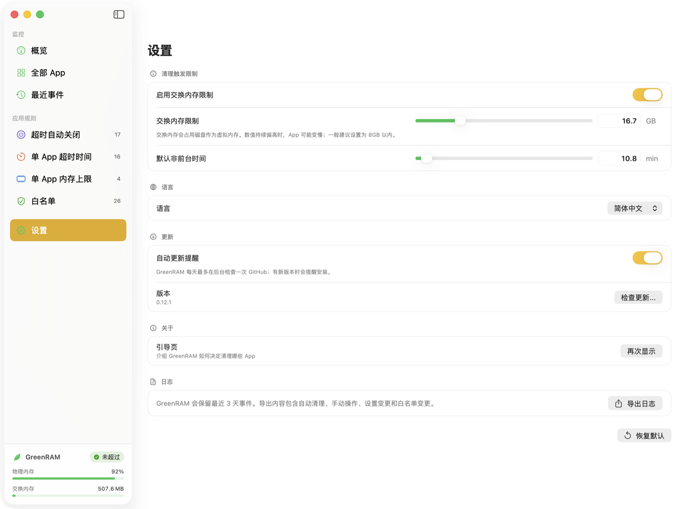

# GreenRAM

[中文说明](README.zh-CN.md) | [Changelog](CHANGELOG.md)

GreenRAM is a macOS menu bar app that watches system memory and force quits long-idle background apps under clear rules.

It is built for a simple case: keep the frontmost app responsive, remove background apps that should be gone, and leave protected apps alone.

## Screenshots

### Menu



### Settings



## Features

- Menu bar memory status with a green/red leaf icon; click it for a panel with RAM / Swap, the top memory apps, and quick actions.
- Main window with a sidebar: overview, all apps, recent events, each app rule, and settings in one place.
- Memory map: every app laid out as a treemap sized by its whole process tree, plus a memory composition bar (app memory, wired, compressed, cached files, free).
- Welcome guide on first launch explaining the cleanup rules; it can be shown again from Settings.
- RAM status display and a configurable Swap limit.
- Auto-Quit Apps quit by non-frontmost time only.
- Ordinary non-whitelisted apps quit after their non-frontmost timeout plus either a system memory gate or their own app memory limit.
- Manual "Clean Apps Now" action.
- Editable whitelist support for apps that should not be quit.
- Multi-process memory accounting for browsers, Electron apps, Xcode helpers, and similar app trees.
- Idle child process cleanup: ends idle CLI tools, language servers, MCP servers, and other external child processes without quitting their app.
- Child process attribution: expand an app on the main window's "All Apps" page to see the processes it spawned.
- Localized UI for Simplified Chinese, Traditional Chinese, English, Japanese, German, and French.

## Supported macOS Versions and Architectures

- macOS 13.0 Ventura or later, including macOS 14 Sonoma and macOS 15 Sequoia.
- Release packages are Universal 2 and support both Apple Silicon (`arm64`) and Intel (`x86_64`) Macs.
- Local SwiftPM builds use the current Mac architecture unless you explicitly build a Universal 2 binary.

## Current Cleanup Policy

GreenRAM uses three rule groups:

- Whitelist: if an app is still in the whitelist, it is never quit. Finder, Dock, WindowServer, System Settings, and System Preferences are included by default, but they are only initial entries; every whitelist item can be removed, re-added, or edited in Settings.
- Auto-Quit Apps: for small utilities you open and leave. They only check non-frontmost time. Once that app's background-time threshold is reached, the app is force quit. RAM and Swap limits do not participate.
- Ordinary apps: apps outside both the whitelist and the Auto-Quit Apps list. They are force quit only when their non-frontmost time threshold has passed and either system memory is over the configured limit or that app exceeds its own memory limit.

For ordinary apps, the memory gate can be system-level or app-level. System-level means RAM reaches its built-in threshold, or the enabled Swap limit is reached. App-level means a Bundle ID has its own memory limit and the app's memory reaches it.

Non-frontmost time starts when an app leaves the foreground. The default threshold is 30 minutes. It can be changed in Settings, with a minimum of 3 minutes. Any app can have a custom app timeout; apps without one use the global default.

Protected apps cannot be added to Auto-Quit Apps, App Timeouts, or App Memory Limits. Remove an app from the whitelist before adding other rules. Adding an app to the whitelist removes it from Auto-Quit Apps; custom app timeouts and memory limits are preserved but do not affect the app while it is protected.

GreenRAM itself, the current frontmost app, and processes without a Bundle ID never enter the cleanup list.

App type, Bundle ID keywords, and app-name keywords do not decide whether an app is cleanable.

When multiple apps are cleanable, GreenRAM handles the apps that have stayed in the background longest first. Per-app memory is also used as a tie-breaker and for display.

Each automatic sweep force quits at most 3 cleanable apps by default. Automatic sweeps have a 60-second cooldown, and the same Bundle ID is not requested again for 10 minutes. Manual "Clean Apps Now" uses the same cleanable-app criteria.

## Idle Child Process Cleanup

GreenRAM cleans idle external child processes inside an app's process tree without quitting the app itself. The typical case is language servers and MCP servers started by Claude Code or an IDE that stay resident after the session or project goes idle.

- External child process: its executable is not inside any `.app` bundle and it has no controlling terminal. An app's own helpers (Electron, WebKit, and similar) and interactive terminal jobs are never touched.
- The cleanup unit is a child process group: an external process whose parent is not external, together with all of its descendants. Groups are cleaned as a whole; a single process inside a group is never killed on its own.
- A group is cleaned only when every process in it has been idle for 30 minutes (less than 3 seconds of CPU time growth) and the group uses at least 100 MB in total. Idle time is measured from GreenRAM's launch.
- Children of the frontmost app are kept. The whitelist only protects apps from being quit; it does not affect child process cleanup.
- GreenRAM sends SIGTERM, then SIGKILL to processes still running 5 seconds later. Each group is attempted once.
- Recent Events records every cleaned group: owning app, process count, memory, idle time, and each process's command name and PID.
- On the main window's "All Apps" page, expand an app to see its child processes merged by command name, with count, memory, and how many idle ones will be cleaned.

For example, a Claude Code stdio MCP server restarts automatically the next time the session calls that tool.

## Never Quit Rules

GreenRAM never quits:

- GreenRAM itself
- the frontmost app
- whitelisted apps
- background apps that have not reached the configured background-time threshold
- ordinary apps while system memory is below the ordinary-app cleanup limit and the app is below its own memory limit

Whitelist protection also blocks rule assignment: a whitelisted app must be removed from Protected Apps before it can be added to Auto-Quit Apps, App Timeouts, or App Memory Limits.

## Download

Download the latest signed and notarized DMG from the [Releases](../../releases) page.
Automatic in-app updates prefer the signed and notarized `GreenRAM-<version>.app.zip` app archive attached to the same release.

## Build

```sh
swift build -c release
```

Run locally:

```sh
swift run GreenRAM
```
