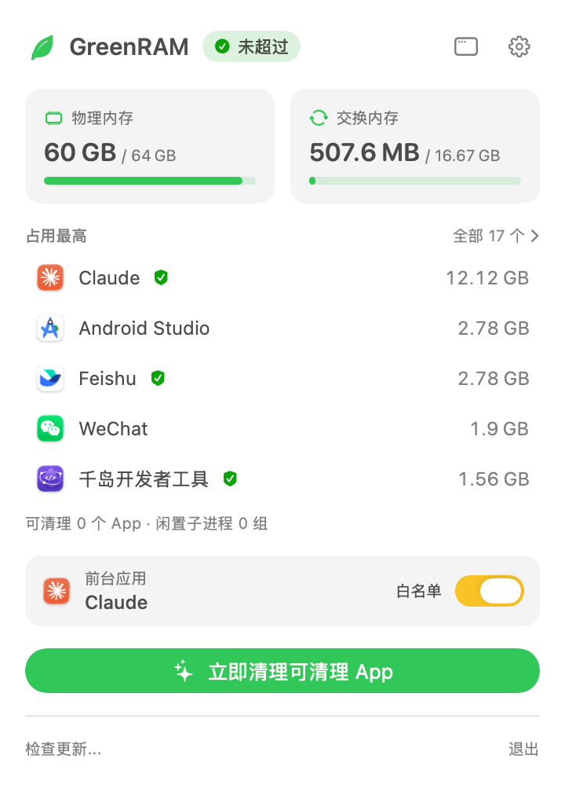
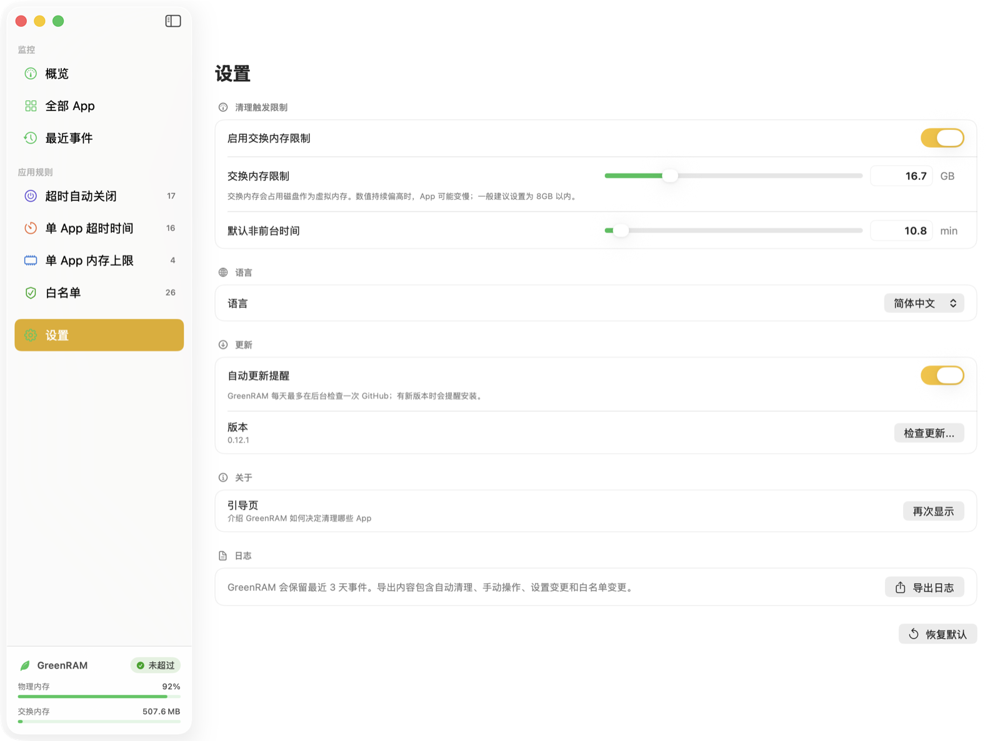

# GreenRAM

[English](README.md) | [更新日志](CHANGELOG.zh-CN.md)

GreenRAM 是一个 macOS 菜单栏 App。它会观察系统内存状态，并按清晰规则强制退出闲置太久的后台 App。

它解决的是一个简单问题：让当前前台 App 保持响应，把该退出的后台 App 清掉，把不该退出的 App 留住。

## 截图

### 菜单



### 设置



## 功能

- 菜单栏内存状态，使用绿色 / 红色叶子图标；点击弹出面板，查看 RAM / Swap、占用最高的 App 和常用操作。
- 带侧栏的主窗口：概览、全部 App、最近事件、各类 App 规则和设置集中在一处。
- 内存平铺：所有 App 按整个进程树的内存平铺成矩形树图，另有内存构成条（App 内存、联动内存、已压缩、缓存文件、可用）。
- 首次启动显示引导页，介绍清理规则；可在设置中再次打开。
- RAM 状态展示，以及可配置的 Swap 限制。
- 超时自动关闭 App 只看非前台时间，到点就退出。
- 普通非白名单 App 达到非前台超时后，还需要满足系统内存超限或自己的单 App 内存上限才会退出。
- 手动 `Clean Apps Now` 操作。
- 可编辑白名单，用于保护不应退出的 App。
- 多进程内存统计，覆盖浏览器、Electron App、Xcode helper 等 App 进程树。
- 闲置子进程清理：自动结束 App 名下闲置的 CLI 工具、语言服务器、MCP server 等外部子进程，不退出 App。
- 子进程归属：在主窗口「全部 App」中展开某个 App，查看它拉起的子进程。
- 本地化 UI：简体中文、繁体中文、英文、日文、德文、法文。

## 支持的 macOS 版本和架构

- macOS 13.0 Ventura 或更新版本，包括 macOS 14 Sonoma 和 macOS 15 Sequoia。
- 发布包是 Universal 2，同时支持 Apple Silicon (`arm64`) 和 Intel (`x86_64`) Mac。
- 本地 SwiftPM 构建默认使用当前 Mac 架构，除非你显式构建 Universal 2 二进制文件。

## 当前清理策略

GreenRAM 的清理规则分三组：

- 白名单：只要 App 仍在白名单里，就永远不会被退出。Finder、Dock、WindowServer、System Settings、System Preferences 默认在白名单里，但它们只是初始项；每个白名单项都可以在 Settings 中移除、重新加入或编辑。
- 超时自动关闭 App：适合随用随走的小工具 App。它只看非前台时间；达到这个 App 的非前台时间阈值后，就会被强制退出。RAM 和 Swap 是否超限不参与判断。
- 普通 App：不在白名单、也不在超时自动关闭列表里的 App。它必须先达到自己的非前台时间阈值，并且满足系统内存超限或该 App 超过自己的内存上限，才会被强制退出。

普通 App 的内存 gate 可以是系统级，也可以是单 App 级。系统级是 RAM 达到内置阈值，或启用的 Swap 达到配置限制。单 App 级是某个 Bundle ID 配了自己的内存上限，且该 App 内存达到上限。

非前台时间从 App 离开前台后开始计算。默认阈值是 30 分钟，可以在 Settings 中修改，最低 3 分钟。任何 App 都可以配置单 App 超时时间；没配置的 App 使用全局默认值。

白名单 App 不能添加到超时自动关闭 App、单 App 超时时间、单 App 内存上限。必须先从白名单移除，才能添加其他规则。把一个 App 加入白名单时，会把它从超时自动关闭 App 移除；单 App 超时时间和单 App 内存上限会保留，但 App 仍在白名单期间不会生效。

GreenRAM 自己、当前前台 App、没有 Bundle ID 的进程，不会进入清理列表。

App 类型、Bundle ID 关键词、App 名称关键词，都不决定某个 App 是否可清理。

当多个 App 都可清理时，GreenRAM 会优先处理非前台时间最长的 App。单个 App 内存也用于排序并列时的次要条件和状态展示。

每次自动清理默认最多强制退出 3 个可清理 App。自动清理有 60 秒冷却时间，同一个 Bundle ID 在 10 分钟内不会重复请求退出。手动 `Clean Apps Now` 使用同一套可清理条件。

## 闲置子进程清理

GreenRAM 会清理 App 进程树里闲置的外部子进程，不退出 App 本身。典型场景是 Claude Code、IDE 拉起的语言服务器、MCP server：会话或项目闲置后仍常驻内存。

- 外部子进程：可执行文件不在任何 `.app` bundle 内，且不挂在终端上。App 自己的 helper（Electron、WebKit 等）和终端里的交互任务都不碰。
- 清理单位是子进程组：父进程不是外部进程的那个外部进程，连同它的全部子孙。只整组清理，不单杀组内某个进程。
- 整组闲置 30 分钟以上（期间 CPU 时间增长不足 3 秒），且合计内存达到 100 MB，才会清理。闲置时间从 GreenRAM 启动后开始计算。
- 前台 App 的子进程不清理。白名单只保护 App 不被退出，不影响子进程清理。
- 先发 SIGTERM，5 秒后仍未退出的进程发 SIGKILL。每个子进程组只尝试一次。
- 最近事件会记录每个被清理的子进程组：所属 App、进程数、内存、闲置时长，以及每个进程的命令名和 PID。
- 主窗口「全部 App」中可以展开每个 App，查看按命令名归并的子进程数量、内存和待清理的闲置进程数。

例如 Claude Code 的 stdio MCP server 被清理后，会话下次调用该工具时会自动重启。

## 永不退出规则

GreenRAM 永远不会退出：

- GreenRAM 自己
- 当前前台 App
- 白名单 App
- 未达到配置后台时间阈值的后台 App
- 系统内存未超限、且没有超过自身内存上限的普通 App

白名单也会阻止规则添加：白名单 App 必须先从保护 App 中移除，才能加入超时自动关闭 App、单 App 超时时间或单 App 内存上限。

## 下载

从 [Releases](../../releases) 页面下载最新已签名并完成 notarize 的 DMG。
App 内自动更新优先使用同一 release 附带的已签名、已 notarize 的 `GreenRAM-<version>.app.zip` App 压缩包。

## 构建

```sh
swift build -c release
```

本地运行：

```sh
swift run GreenRAM
```
